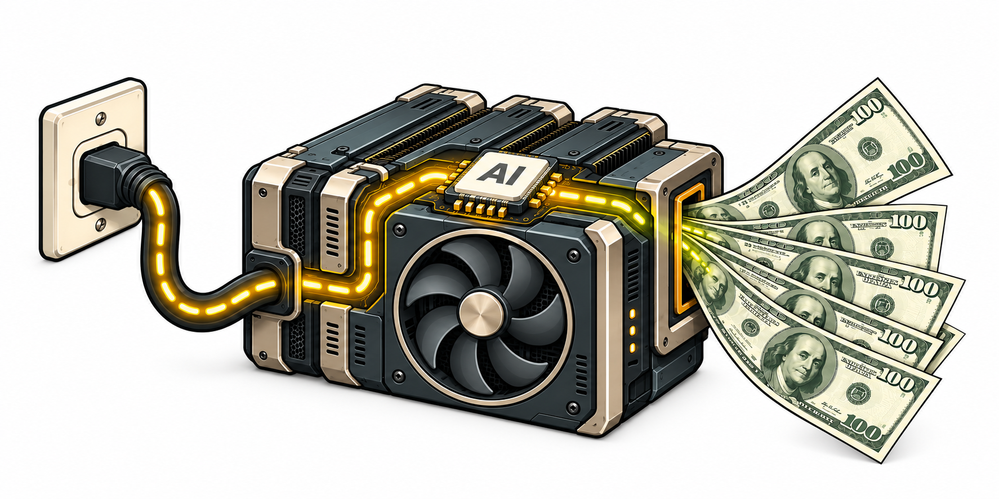
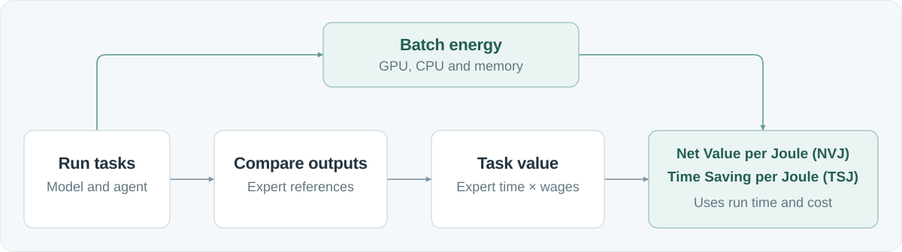

<div align="center">
  <h1 align="left">
    
    Joules-to-GDP: How Much Economic Value Do AI Systems Produce per Unit of Energy?
  </h1>
  <p>
    <a href="https://arxiv.org/abs/2610.30858"></a>
    <a href="https://huggingface.co/datasets/openai/gdpval"></a>
    <a href="https://huggingface.co/datasets/ScalingIntelligence/joules-to-gdp"></a>
  </p>
  <p>
    
  </p>
  <p>
    <a href="#get-started">Get started</a> &nbsp;·&nbsp;
    <a href="#pipeline">Pipeline</a> &nbsp;·&nbsp;
    <a href="#modules">Modules</a> &nbsp;·&nbsp;
    <a href="#nvj-and-tsj">NVJ &amp; TSJ</a> &nbsp;·&nbsp;
    <a href="#about">About</a> &nbsp;·&nbsp;
    <a href="#sponsors">Sponsors</a> &nbsp;·&nbsp;
    <a href="#citation">Citation</a> &nbsp;·&nbsp;
    <a href="#license">License</a> &nbsp;·&nbsp;
    <a href="https://github.com/HazyResearch/intelligence-per-watt">Intelligence Per Watt</a>
  </p>
</div>

Joules to GDP measures the economic return of AI work per unit of energy. Its goal is to compare models, deployments, and occupational tasks by the value of completed work and expert time saving, alongside the cost and energy required to run them.

The code runs tasks, compares the outputs with expert references, and records batch GPU, CPU, and memory energy using [Intelligence Per Watt (IPW)](https://github.com/HazyResearch/intelligence-per-watt). It uses recorded expert completion times and occupation median hourly wages to assign output dollar value, then calculates Net Value per Joule (NVJ) and Time Saving per Joule (TSJ) from judged outcomes, AI-system execution cost, completion times, and measured energy.

## Get started

Install Python 3.13 and [uv](https://docs.astral.sh/uv/). Get the code and install dependencies from the lockfile:

```bash
git clone https://github.com/HazyResearch/joules_to_gdp.git
cd joules_to_gdp
uv sync --project intelligence-per-watt --locked --extra analysis
```

Run the Joules to GDP smoke test with fabricated inputs. It checks batch energy accounting, task value, execution cost, NVJ, and TSJ without a model server or API keys:

```bash
uv run --project intelligence-per-watt --no-sync python reproduction/smoke_test.py
```

The command uses the shared locked Python environment. To run tasks and collect measurements, install the additional dependencies in the run guide below.

Then choose a guide:

| Start here | Guide |
| --- | --- |
| Understand task inputs | [IPW task data interface](intelligence-per-watt/src/ipw/datasets/base.py) |
| Collect energy while running tasks | [Measured runs](reproduction/README.md#run-with-measurement) · [Build the meter](energy-monitor/README.md#build) |
| Configure a model endpoint | [vLLM serving guide](reproduction/vllm/README.md) |
| Calculate metrics from input files | [Analysis guide](analysis/README.md#run-calculations) |

For a worked experiment, see the [GDPVal example](reproduction/README.md).

## Pipeline

<p align="center">
  <a href="assets/pipeline.svg">
    
  </a>
</p>

## What's included

- **Task execution:** [Run AI tasks](intelligence-per-watt/README.md) and save outputs and completion times. The [vLLM guide](reproduction/vllm/README.md) covers model setup.
- **Energy profiling:** [Record batch GPU, CPU, and memory (DRAM) energy](energy-monitor/README.md) and assign it to tasks.
- **Judging:** [Compare outputs with expert references](cluster/README.md) using OpenAI, Anthropic, or Gemini judges.
- **Output dollar value:** [Use expert completion time and occupation median hourly wages](occupation_data/README.md#task-valuation), with BLS wage and O*NET occupation data.
- **Calculations:** [Calculate NVJ and TSJ](analysis/README.md#nvj-and-tsj) from judged outcomes, completion times, execution cost, and measured energy.
- **Setup and tests:** [Configure runs and check inputs](reproduction/README.md), install dependencies from lockfiles, and run tests with fabricated data.

## Modules

<table>
  <tr>
    <td width="33%" valign="top">
      <h3><a href="intelligence-per-watt/README.md">🤖 Run tasks</a></h3>
      <p>Run AI tasks and save the outputs and completion times.</p>
      <p><a href="intelligence-per-watt/README.md#run-a-task-selection">Run tasks →</a></p>
      <details>
        <summary>Details</summary>
        <p>Provide task instructions and reference files, choose a model, and collect outputs, run records, and quality scores.</p>
      </details>
    </td>
    <td width="33%" valign="top">
      <h3><a href="energy-monitor/README.md">⚡ Measure energy</a></h3>
      <p>Record GPU, CPU, and DRAM energy for each batch.</p>
      <p><a href="energy-monitor/README.md">Measure →</a> &nbsp; <a href="analysis/README.md#complete-energy-inputs">Assign to tasks →</a></p>
      <details>
        <summary>Details</summary>
        <p>Measure each batch once, then assign its energy to tasks using their start and finish times. Memory usage is recorded separately.</p>
      </details>
    </td>
    <td width="33%" valign="top">
      <h3><a href="cluster/README.md">⚖️ Judge the work</a></h3>
      <p>Compare two outputs with their source hidden and record wins, ties, and losses.</p>
      <p><a href="cluster/README.md#entry-points">Prepare and judge →</a></p>
      <details>
        <summary>Details</summary>
        <p>The judge reads the task instructions, reference files, and two anonymous outputs, then returns a win, tie, or loss.</p>
      </details>
    </td>
  </tr>
  <tr>
    <td width="33%" valign="top">
      <h3><a href="occupation_data/README.md#task-valuation">💰 Value the output</a></h3>
      <p>Calculate output dollar value from expert completion time and occupation median hourly wages.</p>
      <p><a href="occupation_data/README.md">Source data →</a> &nbsp; <a href="analysis/README.md">Calculate value →</a></p>
      <details>
        <summary>Details</summary>
        <p>Multiply expert completion time by the occupation median hourly wage to get output dollar value. A win or tie against the expert reference receives this value credit.</p>
      </details>
    </td>
    <td width="33%" valign="top">
      <h3><a href="analysis/README.md#nvj-and-tsj">📈 Calculate NVJ &amp; TSJ</a></h3>
      <p>Calculate net dollar value and time saving per joule.</p>
      <p><a href="#nvj-and-tsj">What the metrics mean →</a> &nbsp; <a href="analysis/README.md#run-calculations">Calculate →</a></p>
      <details>
        <summary>Details</summary>
        <p>The calculations use judged outcomes, expert and AI-system completion times, output dollar value, execution cost, and measured energy.</p>
      </details>
    </td>
    <td width="33%" valign="top">
      <h3><a href="reproduction/README.md">🧭 Set up a run</a></h3>
      <p>Choose tasks, a model, hardware, and run settings.</p>
      <p><a href="reproduction/README.md#preview-a-schedule">Preview →</a> &nbsp; <a href="reproduction/README.md#run-with-measurement">Run →</a></p>
      <details>
        <summary>Details</summary>
        <p>Preview a task schedule, then start a measured run with the selected model and hardware.</p>
      </details>
    </td>
  </tr>
</table>

## Architecture

```text
intelligence-per-watt/   Run tasks, connect models, collect measurements
energy-monitor/         Measure batch GPU, CPU, and memory energy
cluster/                Prepare work for anonymous comparisons and judge it
occupation_data/        Wage and occupation source data
analysis/               Calculate output value, execution cost, NVJ, and TSJ
reproduction/           Configure runs, check inputs, and run calculations
scripts/                Build the energy meter and check release contents
```

## NVJ and TSJ

| Metric | What it measures |
| --- | --- |
| **NVJ — Net Value per Joule** | Credited output dollar value minus AI-system execution cost, divided by measured energy. |
| **TSJ — Time Saving per Joule** | Time saving credited to wins or ties, divided by measured energy. Time saving is expert completion time minus AI-system completion time. |

A win or tie against the selected expert reference receives output-value and time-saving credit. Every run contributes execution cost and energy. The numerical outputs report NVJ in **USD/MJ** and TSJ in **hours/MJ**; one megajoule is one million joules. See the [metric definitions](analysis/README.md#nvj-and-tsj).

## Inputs and outputs

Datasets: [GDPVal](https://huggingface.co/datasets/openai/gdpval) and [GDPWorks](https://huggingface.co/datasets/ScalingIntelligence/joules-to-gdp) (83 tasks). The supplied [run example](reproduction/README.md) uses GDPVal.

The repository includes BLS wage data, O*NET® occupation data, and fabricated test data. The [input manifest](reproduction/input_manifest.json) lists bundled files and separately supplied inputs. Saved runs, judgments, calculated values, and generated metrics go into ignored output directories.

<details>
  <summary><strong>Add and check input files</strong></summary>
  <p>Use the <a href="reproduction/README.md#verify-external-inputs">input guide</a> to check files and set them up for collection and analysis.</p>
</details>

<details>
  <summary><strong>Project artwork</strong></summary>
  <p><a href="assets/project-mark.png">Project mark</a> · <a href="assets/ai-gpu-cash-flow.png">GPU illustration</a> · <a href="assets/pipeline.svg">Pipeline SVG</a> · <a href="assets/j2g.png">Additional artwork</a></p>
</details>

## About

Joules to GDP is developed at [Hazy Research](https://hazyresearch.stanford.edu/) and the [Scaling Intelligence Lab](https://scalingintelligence.stanford.edu/) at [Stanford SAIL](https://ai.stanford.edu/).

## Citation

If you use Joules-to-GDP in your research, please cite:

```bibtex
@misc{zeinali2026joulestogdpeconomicvalueai,
      title={Joules-to-GDP: How Much Economic Value Do AI Systems Produce per Unit of Energy?},
      author={Amirreza Zeinali and Jon Saad-Falcon and Avanika Narayan and Mersad Abbasi and Jonathan S. Hartley and John Hennessy and Christopher Re and Azalia Mirhoseini},
      year={2026},
      eprint={2610.30858},
      archivePrefix={arXiv},
      primaryClass={cs.LG},
      url={https://arxiv.org/abs/2610.30858},
}
```

## Sponsors

[Snorkel AI](https://snorkel.ai/) · [Modal](https://modal.com/) · [Laude Institute](https://www.laude.org/) · [Google Cloud Platform](https://cloud.google.com/) · [IBM Research](https://research.ibm.com/) · [Stanford HAI](https://hai.stanford.edu/) · [Stanford Marlowe](https://datascience.stanford.edu/marlowe)

## License

The code uses the [Apache-2.0 license](LICENSE). BLS and O*NET source data have their own [terms and attribution](occupation_data/README.md#sources-and-attribution).
